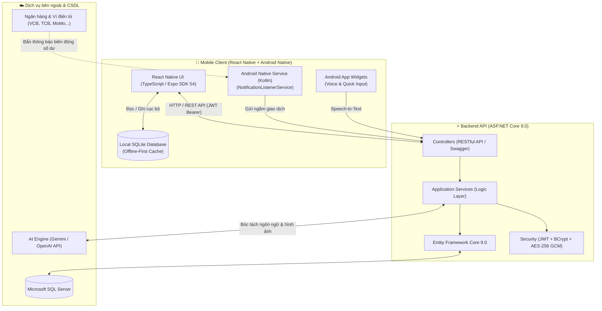

# 🌟 AI Daily Expense (Quản Lý Cá Nhân & Trợ Lý Học Tập AI)

> **Hệ thống Fullstack quản lý tài chính thông minh, lên lịch công việc tự động và hỗ trợ học ngoại ngữ Flashcard với thuật toán lặp lại ngắt quãng (Spaced Repetition), tích hợp AI NLP và dịch vụ chạy ngầm Android Native.**

[](https://dotnet.microsoft.com/)
[](https://reactnative.dev/)
[](https://expo.dev/)
[](https://kotlinlang.org/)
[](https://www.typescriptlang.org/)
[]()
[-brightgreen.svg)]()

---

## 📌 1. TỔNG QUAN KIẾN TRÚC HỆ THỐNG

Hệ thống được thiết kế theo mô hình **Client - Server hiện đại** kết hợp với **Android Native Service** và **Mô hình Offline-First**:



---

## 🚀 2. CÁC ĐIỂM SÁNG KỸ THUẬT NỔI BẬT (ENGINEERING HIGHLIGHTS)

### 1. 🤖 Kiến trúc AI Hybrid (Chống ảo giác & Hậu kiểm bằng C#)
* **Bóc tách đa năng (Unified Natural Language Parser):** Người dùng chỉ cần gõ hoặc nói tự nhiên (ví dụ: *"sáng ăn phở 40k trưa đổ xăng 50k chuyển khoản"* hoặc *"ngày mai 9h họp nhóm nhắc tôi trước 15 phút"*), AI tự phân loại thành chi tiêu hoặc công việc.
* **Quy tắc Lemmatization (Đưa về từ nguyên mẫu):** Khi phân tích từ vựng tiếng Anh, AI tự động chuyển các dạng chia thì/biến thể (`stopped`, `running`, `played`, `happier`) về từ gốc từ điển (`stop`, `run`, `play`, `happy`) trước khi tạo thẻ Flashcard.
* **Cơ chế phòng vệ C# (Defensive Post-Processing):**
  - Dùng **MoneyParser (Regex)** để đối chiếu số tiền, không để AI đọc nhầm số dư hoặc số tài khoản thành tiền giao dịch.
  - Tự động map Category vào CSDL thật của người dùng, tự động fallback nếu AI trả về sai format.
  - Bộ timeout 18s tự động ngắt kết nối và kích hoạt **Fallback offline** để không bao giờ làm treo app.

### 2. 📱 Android Native Service & Xử lý vòng đời ngầm (Background OS Lifecycle)
* Tự viết Service Android bằng Kotlin (`NotificationListenerService`) để bắt thông báo biến động số dư từ các app ngân hàng (Vietcombank, Techcombank, MB, ACB, MoMo, ZaloPay, ViettelPay...).
* **Kỹ thuật Re-bind (Component Toggle):** Khắc phục triệt để lỗi "chết lâm sàng" kinh điển trên các dòng máy Android (Xiaomi, Oppo, Samsung) khi hệ điều hành tối ưu pin (Doze Mode). Mỗi khi mở app, service tự động được "sốc điện" hồi sinh 100%.
* **Thuật toán Deduplication 24h & Khóa thời gian 15 phút:** Nhóm mã băm (`dayBucket`) theo chu kỳ 24 giờ và chỉ quét bù thông báo trong vòng 15 phút gần nhất, chấm dứt hoàn toàn hiện tượng gửi trùng lặp hoặc gọi API oan.

### 3. 📚 Flashcard học tập Offline-First & Thuật toán lặp lại ngắt quãng (SM-2)
* **Offline-First:** Tích hợp `expo-sqlite` lưu trữ toàn bộ thẻ học cục bộ trên máy. Người học không cần kết nối mạng vẫn ôn bài mượt mà.
* **SuperMemo SM-2 Algorithm:** Hệ thống tự động tính toán hệ số dễ (`EaseFactor`), số ngày giãn cách (`IntervalDays`) và ngày cần ôn tiếp theo (`NextReviewDate`) dựa trên đánh giá của người học (`Forgot`, `Hard`, `Good`, `Easy`).
* **Hàng đợi đồng bộ bù (Offline Sync Queue):** Khi có kết nối mạng trở lại, ứng dụng tự động đồng bộ kết quả ôn tập lên máy chủ SQL Server trong nền.

### 4. 🔐 Két bảo mật tài khoản (Zero-Knowledge Vault)
* Quản lý mật khẩu và tài khoản nhạy cảm với thuật toán mã hóa đối xứng chuẩn quân đội **AES-256 GCM** (kèm Nonce 12-byte và AuthTag 16-byte).
* Xác thực hai lớp: Chỉ giải mã khi người dùng nhập đúng mã OTP gửi qua Email hoặc mã PIN két sắt đã băm bảo vệ.

---

## 🛠️ 3. CÔNG NGHỆ SỬ DỤNG

| Tầng | Công nghệ / Thư viện |
| :--- | :--- |
| **Backend API** | ASP.NET Core 9.0 Web API, Entity Framework Core 9.0, C# 13 |
| **Bảo mật** | JWT Bearer Token, BCrypt.Net-Next, AES-256 GCM (`AesGcm`), SHA-256 |
| **Tài liệu API** | Swagger UI (Swashbuckle.AspNetCore) |
| **Cơ sở dữ liệu** | Microsoft SQL Server (Máy chủ), SQLite (Thiết bị di động) |
| **Mobile App** | React Native 0.81, Expo SDK 54, TypeScript 5.9 |
| **Native Android** | Kotlin 2.1, NotificationListenerService, AppWidgetProvider |
| **Testing** | xUnit, Microsoft.NET.Test.Sdk (29 Unit Tests) |
| **AI Integration** | Google Gemini API (2.0 Flash / 3.1 Flash Lite), OpenAI API (GPT-4o Mini) |

---

## 📂 4. CẤU TRÚC THƯ MỤC DỰ ÁN

```text
ProjectQuanLyCaNhan/
│
├── backend/
│   ├── AiDailyExpense.Api/           # Dự án ASP.NET Core Web API (.NET 9.0)
│   │   ├── Controllers/              # RESTful API Endpoints (Auth, Expenses, Tasks, AI, Study...)
│   │   ├── Data/                     # AppDbContext, Seed Data
│   │   ├── DTOs/                     # Data Transfer Objects cho Request / Response
│   │   ├── Helpers/                  # MoneyParser, JwtHelper, DateTimeHelper, ApiResponse
│   │   ├── Models/                   # Entity Models SQL Server
│   │   ├── Services/                 # Business Logic (AiService, ExpenseService, StudyService...)
│   │   ├── appsettings.json          # File cấu hình mẫu (đã ẩn các khóa bí mật)
│   │   └── appsettings.Example.json  # Bản hướng dẫn cấu hình mẫu cho Developer
│   │
│   └── AiDailyExpense.Tests/         # Dự án Unit Test tự động (xUnit)
│       ├── MoneyParserTests.cs       # Kiểm thử bóc tách tiền tệ tiếng Việt
│       ├── SpacedRepetitionAlgorithmTests.cs # Kiểm thử thuật toán SM-2
│       ├── AuthSecurityTests.cs      # Kiểm thử mã hóa AES-GCM & băm BCrypt
│       └── DateTimeHelperTests.cs    # Kiểm thử múi giờ & chuyển đổi ngày tháng
│
├── mobile/
│   └── AiDailyExpense.Mobile/        # Ứng dụng di động React Native Expo
│       ├── android/                  # Mã nguồn Android Native (Kotlin)
│       │   └── app/src/main/java/.../
│       │       ├── NotificationReceiverService.kt # Dịch vụ ngầm đọc SMS / Bank Notification
│       │       ├── AiWidgetProvider.kt            # Tiện ích Widget màn hình chính
│       │       └── VoiceWidgetActivity.kt         # Popup ghi âm nhận diện giọng nói
│       └── src/
│           ├── components/           # UI Components tái sử dụng
│           ├── database/             # SQLite Repository & Offline Storage
│           ├── navigation/           # React Navigation (Stack & Tab)
│           ├── screens/              # Màn hình chức năng (Home, Expense, Study, AI...)
│           └── services/             # Axios API Client
│
├── publish.cmd                       # Script 1-click đóng gói Backend ra thư mục publish/
├── build-apk.cmd                     # Script 1-click biên dịch Android APK cài đặt điện thoại
├── build-all.cmd                     # Script 1-click đóng gói toàn bộ hệ thống
└── README.md                         # Tài liệu dự án
```

---

## 🧪 5. KIỂM THỬ PHẦN MỀM (UNIT TESTS)

Dự án bao gồm bộ kiểm thử tự động với **29 test cases** bao phủ các logic nghiệp vụ quan trọng nhất:
* ✅ **MoneyParser:** Xử lý chính xác các biến thể tiền tệ (`40k`, `1.5tr`, `10 triệu`, `50.000đ`, `-120,000VND`).
* ✅ **Spaced Repetition (SM-2):** Đảm bảo hệ số dễ (`EaseFactor`) và chu kỳ lặp lại tăng/giảm chính xác theo phản hồi của người học.
* ✅ **Security & AES-GCM:** Kiểm thử chu trình mã hóa và giải mã dữ liệu két sắt với xác thực AuthTag.
* ✅ **DateTime & Timezone:** Đảm bảo chuyển đổi chính xác giữa giờ UTC và giờ địa phương Việt Nam (`Asia/Ho_Chi_Minh` / `UTC+7`).

### Cách chạy Unit Tests:
```bash
dotnet test AiDailyExpense.slnx
```
*Kết quả mẫu:*
```text
Passed!  - Failed: 0, Passed: 29, Skipped: 0, Total: 29, Duration: 642 ms
```

---

## ⚡ 6. HƯỚNG DẪN KHỞI CHẠY DỰ ÁN

### Yêu cầu tiên quyết:
- **.NET SDK 9.0 trở lên**
- **Node.js v18 trở lên**
- **SQL Server** (LocalDB, SQL Express hoặc Docker SQL Server)

---

### Khởi chạy Backend API
1. Truy cập thư mục backend:
   ```bash
   cd backend/AiDailyExpense.Api
   ```
2. Cấu hình chuỗi kết nối Database và API Key trong `appsettings.json` (tham khảo `appsettings.Example.json`).
3. Khôi phục thư viện và chạy:
   ```bash
   dotnet restore
   dotnet run
   ```
4. Truy cập giao diện Swagger UI tại: [http://localhost:5000/swagger](http://localhost:5000/swagger)

*Tài khoản thử nghiệm mặc định:*
- **Email:** `test@example.com`
- **Mật khẩu:** `123456`

---

### Khởi chạy Mobile App (Expo)
1. Truy cập thư mục mobile:
   ```bash
   cd mobile/AiDailyExpense.Mobile
   ```
2. Cài đặt các gói phụ thuộc:
   ```bash
   npm install
   ```
3. Khởi động Expo Metro Bundler:
   ```bash
   npx expo start
   ```
4. Mở ứng dụng **Expo Go** trên điện thoại và quét mã QR để trải nghiệm.

---

## 📦 7. ĐÓNG GÓI PHÁT HÀNH (BUILD SCRIPTS)

Bạn có thể tạo bản phát hành sản phẩm dễ dàng bằng các script 1-click tại thư mục gốc:

* 📦 **Đóng gói file cài đặt Android APK:** Nhấp đúp vào [`build-apk.cmd`](file:///e:/Documents/ProjectQuanLyCaNhan/build-apk.cmd)  
  ➔ File thành phẩm: `mobile/AiDailyExpense.Mobile/android/app/build/outputs/apk/release/app-release.apk`
* 🌐 **Đóng gói Backend Server:** Nhấp đúp vào [`publish.cmd`](file:///e:/Documents/ProjectQuanLyCaNhan/publish.cmd)  
  ➔ Thư mục thành phẩm: `publish/` (sẵn sàng tải lên IIS / VPS / Cloud)
* 🚀 **Đóng gói toàn bộ:** Nhấp đúp vào [`build-all.cmd`](file:///e:/Documents/ProjectQuanLyCaNhan/build-all.cmd)

---

## 👨‍💻 Tác giả
- **TÀI (Fullstack Developer)**
- Dự án mã nguồn mở phục vụ nghiên cứu, học tập và portfolio nghề nghiệp.
